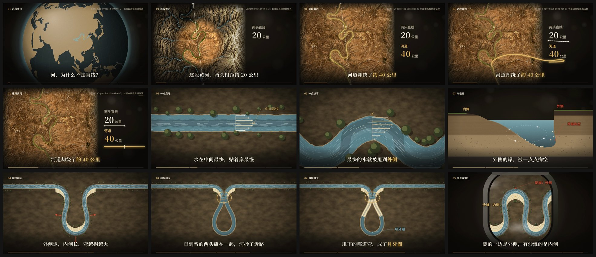
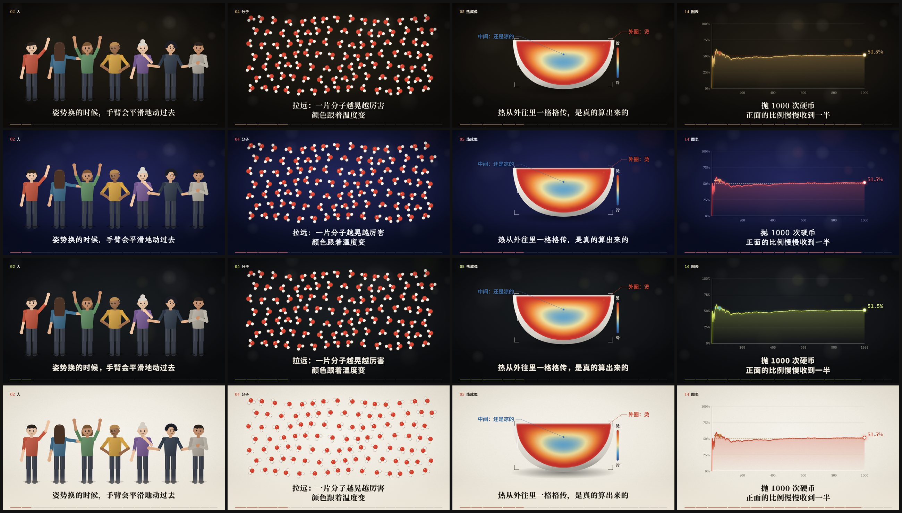

# vibe-knowledge-maker · Vibe知识大赏 一句话出片

一个让 AI 帮你做 **Vibe知识大赏** 式知识短片的 skill：没有人声，一屏一句字幕，画面把这句话演出来，关着声音也看得懂。

你只要说一句「做一条知识短片：为什么冬天的风那么冷」，AI 会自己定题查证、写剧本、用代码画每个画面、合成配乐和音效、自查、出封面，最后交给你一条 MP4。



上面是自带的示范片《河为什么不走直线》（46 秒）：从太空落到黄河一段真实的峡谷，用高程数据量出两头直线约 20 公里、河道约 40 公里；再把一段河从直的演到弯的、横着切开看岸怎么被掏空、看一道弯越拐越大直到截弯变成月牙湖。它的全部源码都在 `kit/src/film/` 里，可以照着它做你自己的题目。

---

## 怎么装

### 最简单：把地址发给你的 AI

打开你平时用的、能在电脑上干活的 AI 工具（Claude Code、Codex、Cursor、WorkBuddy、Gemini CLI 都行），发这一句：

```
帮我安装这个 skill：https://github.com/xinsober/vibe-knowledge-maker
```

它会自己下载、放到该放的位置。装好以后新开一个对话就能用。AI 会按本页最后的「给 AI 的安装说明」来装，不需要你懂命令行。

### 自己动手装

会用终端的话，装了 Node.js 以后运行：

```bash
npx skills add xinsober/vibe-knowledge-maker
```

或者把整个仓库下载下来，把文件夹改名为 `vibe-knowledge-maker`，整个复制到工具的 skill 目录：

| 工具 | 放到哪里 |
|---|---|
| Claude Code | `~/.claude/skills/` |
| Codex | `~/.agents/skills/` |
| Cursor | `~/.cursor/skills/` |
| WorkBuddy | `~/.workbuddy/skills/` |

### Claude 网页版和 App（claude.ai）

在本页点绿色的 **Code** → **Download ZIP**，然后在 claude.ai → 设置 → 功能 → Skills 上传这个 zip。网页版不能在你电脑上渲染视频，适合拿来写剧本；要出成片，请用上面能在电脑上干活的工具。

---

## 怎么用

装好后正常说话就行：

```
做一条知识短片：为什么冬天的风那么冷
```

AI 写完剧本会停一次，把方案整理成一页给你看，你说「可以」再做画面。不想看方案就在后面加一句「直接做，我看成品」。

第一次用时，AI 会先检查电脑上的环境，缺什么一次列全，问过你再装。需要：Node.js 18 以上、ffmpeg、Python 3（numpy、Pillow）；第一次渲染时 Remotion 会自动下载一个约 100 MB 的浏览器。建议同时装上 Remotion 官方的 skill：`npx skills add remotion-dev/skills`，它管 Remotion 的写法对不对，这个 skill 管片子好不好看、讲没讲清楚。

### 里面有什么

- **一套调好的画面组件**：真实卫星图、真实地形、地球、剖面、流动、分子、热成像、材质、点阵、逐步演算、年份、尺度、图表、分叉、出处、照片、展台、人物
- **四套外观**，不说的话 AI 按题目挑
- **代码合成的配乐和音效**，没有版权问题
- **自动质检**：字号、越界、字叠字、黑场、静止、响度
- **自动出封面**
- **一条完整的示范片源码**

### 四套外观



同一套画面组件，从上到下依次是墨金、夜蓝、信号、纸本。想指定就在那句话后面加上：

| 外观 | 样子 | 适合 | 复制这句 |
|---|---|---|---|
| 墨金 | 暖黑底、象牙白宋体、香槟金强调、胶片颗粒 | 自然、地理、历史、宇宙、经济、概率 | `做一条知识短片：珠穆朗玛峰为什么还在长高。外观用墨金。` |
| 夜蓝 | 靛蓝夜空、月白楷体、珊瑚红强调 | 人、心理、关系、故事、社会现象 | `做一条知识短片：为什么人一紧张就想上厕所。外观用夜蓝。` |
| 信号 | 石墨底、骨白黑体、荧光黄绿强调、等宽数字 | AI、计算机、算法、数据、工程 | `做一条知识短片：手机是怎么认出你的脸的。外观用信号。` |
| 纸本 | 暖白纸、墨黑宋体、朱红强调 | 身体、日常科学、东西怎么工作、生活方法 | `做一条知识短片：微波炉是怎么把饭热了的。外观用纸本。` |

想自己渲示范片：在 `kit` 目录跑 `npm install && npm run audio && npm run render`。想看每个组件在四套外观下的样子：跑 `node scripts/gallery.mjs all`，联系表在 `kit/out/gallery/`。

---

## 授权和数据出处

- 本仓库的代码和文档用 [MIT 协议](LICENSE)，可以随便用、改、商用。
- Remotion 对个人和 3 人以内的公司免费，3 人以上的公司商用要向 Remotion 买授权（[remotion.pro](https://www.remotion.pro)）。
- 字体（思源黑体、思源宋体、霞鹜文楷、JetBrains Mono、DM Serif Display、Inter）都是开源可商用的。
- 示范片的数据：卫星影像 Copernicus Sentinel-2（2025-04-07）；地形数据 Mapzen / AWS Terrain Tiles（含 SRTM、GMTED 等）；世界河流 Natural Earth（公有领域）。你用这些数据做的片子，出处也照这样写。

---

## 给 AI 的安装说明

用户把这个仓库地址发给你、让你安装时，按下面做。

1. **先试命令。** 电脑上有 Node.js 的话，运行
   `npx skills add https://github.com/xinsober/vibe-knowledge-maker -g -y -a <你自己是哪个工具>`
   （`claude-code`、`codex`、`cursor`、`gemini-cli` 等）。
2. **命令用不了就手动装。** 把仓库下载下来（`git clone`，或者下载 ZIP 解压），整个文件夹改名为 `vibe-knowledge-maker`，复制到你自己的个人 skill 目录（不知道在哪就查你这个工具的官方文档，上面的表里是常见的几个）。`SKILL.md` 要在这个文件夹的最外层，`kit`、`docs`、`assets` 都要一起带上，`.git` 可以不要。
3. **装完告诉用户**：装在哪、新开对话后生效、用的时候说「做一条知识短片：题目」就行。
4. **环境等用到时再检查。** 做第一条片子时按 `SKILL.md` 的「开工」跑 `npm run env`，缺什么先告诉用户，用户同意了再装。
